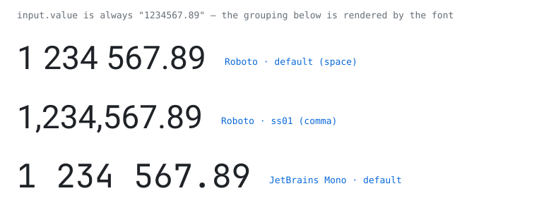

# Tusan!

> *Tusan!* — Swedish for "damn it!", literally an old form of "thousand".
> It's both what this library handles and what you'll say if you try to
> do it in JavaScript. (Not to be confused with *tusán*, the
> Chinese-Peruvian community — an unrelated homonym we tip our hat to.)

**Thousand separators for number inputs — rendered by the font, not the string.**

<picture>
  <source media="(prefers-color-scheme: dark)" srcset="assets/preview-dark.svg">
  
</picture>

**[Live demo →](https://davonium.github.io/tusan/)** · no build step, the fonts are embedded in one HTML file

## The problem

Every JS solution for formatted number inputs fights the browser: caret
mapping across separators, arrow keys landing on phantom positions,
selections that grab a lone separator, backspace eating the wrong thing,
a broken undo stack, mobile IME quirks. Hundreds of lines of code, and
something always leaks.

CSS can't help — there is no `::nth-letter()`, `letter-spacing` is
uniform, and overlay tricks fail because the caret still counts the real
characters. (A [2015 WHATWG proposal](https://lists.w3.org/Archives/Public/public-whatwg-archive/2015Oct/0012.html)
for display-only separators in `<input type=number>` never happened.)

## The idea

Move the separator to the rendering layer. An OpenType `calt` rule swaps
every digit followed by exactly 3·n digits for a variant glyph with the
separator baked into its advance width. The string stays `1234567.89`:

- caret, selection, copy, undo: **100% native** — nothing to skip over
- a separator can never be selected on its own (it isn't a character)
- copy gives plain digits, with zero code
- if the font fails to load you see ungrouped digits — never broken data
- the only JS you still want: input filtering and paste cleanup (~40 lines)

Separator style is a CSS switch: default = space, `ss01` = comma,
`ss02` = period, `ss03` = apostrophe.

## Usage

Locale is auto-detected from the browser and can be overridden per field.
The decimal character and the rendered separator style always come from
the same `Intl` lookup, so mismatched pairs (period grouping with a
period decimal) cannot occur.


```css
@font-face {
  font-family: "Roboto Grouped";
  src: url("/fonts/RobotoGrouped-Regular.woff2") format("woff2"); /* files in docs/fonts/ */
}

.number-input {
  font-family: "Roboto Grouped", Roboto, system-ui, sans-serif;
  font-variant-ligatures: contextual;
  font-feature-settings: "calt" 1; /* explicit: survives UA feature juggling */
  /* font-feature-settings: "calt" 1, "ss01" 1;  <- comma style */
}
```

The patched font contains only `0-9 . , - '`, so everything else
(placeholder, labels) falls back to the next font in the stack — use the
unpatched original there and the seam is invisible.

## Patch your own font

```
pip install fonttools brotli
python3 build_font.py <source.ttf> "<Family Name>" <OutputPrefix>
```

Works on any static TTF (instantiate variable fonts first with
`fontTools.varLib.instancer`). One output file per weight you use in
number fields. Verify shaping with `uharfbuzz` — see `verify.py`.

## How it works

OpenType contextual rules have fixed-length patterns — no quantifiers —
so "followed by a multiple of 3 digits" is expressed as a ladder, with
`ignore sub` encoding "exactly N":

```fea
ignore sub @D' @D @D @D @D;      #  4+ digits follow: skip (handled higher up)
sub    @D' @D @D @D by @Dgrp;    #  exactly 3 follow: group
```

The full ladder covers integer parts up to 24 digits (raise `MAX_LA` in
the script for more — ~3 rules / 20 bytes per extra group). Reverse
chaining (`rsub`) could do unbounded grouping in three rules, but type 6
lookups are the most widely supported mechanism in the wild, so this
project deliberately sticks to them.

## Browser support

The core function works in all current major engines — verified in the
latest Chrome, Firefox and Safari. The shaping is plain GSUB type 6
contextual substitution, the same mechanism ligatures use everywhere.
Degradation is graceful: if the font doesn't load, digits render
ungrouped and the value is unaffected. If visible separators are a hard
requirement rather than an enhancement, use JS formatting instead.

## Known issue: Blink re-shaping

In Chromium, grouping can fail to render when the value crosses into
"grouping needed" territory — e.g. going from empty to filled, or from
3 to 4 digits ("111" → "1 111" stays ungrouped). The exact set of
triggering transitions is unclear, so the robust workaround is to
nudge shaping on every input: toggle ligatures off, force a
synchronous reflow, toggle back on. It runs within one frame —
sub-millisecond, no flicker.

Plain JS:

```js
input.addEventListener("input", () => {
  const s = input.style;
  s.fontVariantLigatures = "none";
  void input.offsetWidth; // force reflow — makes Blink commit
  s.fontVariantLigatures = "contextual";
});
```

React: the npm component does this automatically and exports the
helper as `forceReshape(el)`:

```tsx
import { forceReshape } from "tusan";

<input onInput={(e) => forceReshape(e.currentTarget)} ... />
```

## Limitations


- Full grouping up to 24 integer digits (configurable); decimal digits are never grouped, regardless of length (they are
  inductively marked by the font and excluded from the ladder).
- **Never set `letter-spacing`** on the element. In-the-wild testing shows
  it breaks the grouping entirely in some browsers, and behavior is
  inconsistent across engines (the spec's auto-disable nominally targets
  liga/clig, but reality disagrees). The demo page keeps a letter-spacing
  row as a canary, not as a promise.
- One font file per weight.
- The gap belongs to the digit before it, so a selection ending at a
  group boundary visually covers the gap (which is also why a separator
  can never be selected alone).
- Variant metrics are exactly those of typing the separator character:
  the gap variant advances by one space, the comma variant by the font's
  comma, and so on — so the rendering is metrically identical to real
  separator characters (and to Intl-formatted text next to the field).
- The gap is exactly one space wide, so in
  monospace fonts it occupies exactly one cell — the character grid is
  respected, though line widths still grow versus ungrouped digits,
  which is why [Numderline](https://blog.janestreet.com/commas-in-big-numbers-everywhere/)
  chose underlines for terminals. For proportional UI fonts it's a non-issue.

## Prior art & credits

Font-based digit grouping for *reading* large numbers in terminals was
pioneered by Tristan Hume's **Numderline** (Jane Street blog, 2019).
This project applies the technique to *editable* web inputs, where the
payoff is native caret/selection/copy/undo semantics, and adds locale
styles (`ss01–ss03`), decimal protection and a generic font patcher.

Demo fonts patched from Roboto and JetBrains Mono (SIL OFL — modified
versions renamed as required). Patcher script: MIT.
